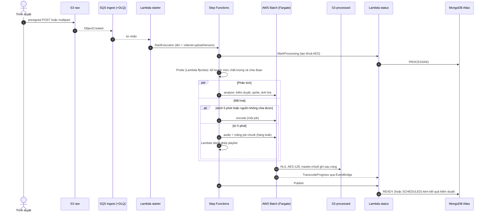

# 🎬 Xây dựng Nền tảng Chia sẻ Video Trực tuyến với Hệ thống Chuyển mã HLS Tự động trên Kiến trúc Serverless Container và Event-Driven
## Building a Video Sharing Platform with Automated HLS Transcoding Pipeline on Serverless Container and Event-Driven Architecture

> **Môn học:** Dự án Công nghệ Thông tin (DACNTT)  
> **Sinh viên thực hiện:**
> - Đinh Quốc Cường (MSSV: 523H0008)
> - Võ Huỳnh Minh Đức (MSSV: 523H0014)
>
> **Giảng viên hướng dẫn:** Thầy ThS. Mai Văn Mạnh  
> **Định hướng chuyên sâu:** DEVOPS, CONTAINERIZATION & CLOUD SYSTEMS  
> **GitHub Repository:** [https://github.com/DinhQuocCuong28664/DACNTT_VideoStreaming](https://github.com/DinhQuocCuong28664/DACNTT_VideoStreaming)  
> **Tên miền ứng dụng (Production Domain):** [https://zelostech.site](https://zelostech.site)

---

## 📋 MỤC LỤC TỔNG QUAN

1. [Tên đề tài](#1-tên-đề-tài)
2. [Thông tin thực hiện](#2-thông-tin-thực-hiện)
3. [Bối cảnh và vấn đề](#3-bối-cảnh-và-vấn-đề)
4. [Mục tiêu của đề tài](#4-mục-tiêu-của-đề-tài)
5. [Các chức năng chính](#5-các-chức-năng-chính)
6. [Quy trình chuyển mã video (Transcoding Pipeline)](#6-quy-trình-chuyển-mã-video)
7. [Phân phối và bảo vệ nội dung (CDN, chữ ký, AES-128)](#7-phân-phối-và-bảo-vệ-nội-dung)
8. [Hạ tầng serverless](#8-hạ-tầng-serverless)
9. [CI và triển khai](#9-ci-và-triển-khai)
10. [Infrastructure as Code (Quản lý hạ tầng bằng Terraform)](#10-infrastructure-as-code)
11. [Công nghệ sử dụng (Tech Stack)](#11-công-nghệ-sử-dụng)
12. [Phương pháp đánh giá (Performance & QoE Evaluation)](#12-phương-pháp-đánh-giá)
13. [Đóng góp kỹ thuật](#13-đóng-góp-kỹ-thuật)
14. [Sản phẩm](#14-sản-phẩm)
15. [Kết quả](#15-kết-quả)

---

## 1. TÊN ĐỀ TÀI

- **Tiếng Việt:** Xây dựng nền tảng chia sẻ video trực tuyến với hệ thống chuyển mã HLS tự động trên kiến trúc Serverless Container và Event-Driven.
- **Tiếng Anh:** Building a Video Sharing Platform with Automated HLS Transcoding Pipeline on Serverless Container and Event-Driven Architecture.

---

## 2. THÔNG TIN THỰC HIỆN

- **Sinh viên thực hiện:**
  1. Đinh Quốc Cường – MSSV: 523H0008 (Email: `523H0008@student.tdtu.edu.vn`)
  2. Võ Huỳnh Minh Đức – MSSV: 523H0014 (Email: `523H0014@student.tdtu.edu.vn`)
- **Giảng viên hướng dẫn:** ThS. Mai Văn Mạnh
- **Đơn vị công tác:** Khoa Công nghệ Thông tin – Trường Đại học Tôn Đức Thắng (TDTU)

---

## 3. BỐI CẢNH VÀ VẤN ĐỀ

Các nền tảng chia sẻ video hiện đại như YouTube, Vimeo và TikTok đều phải giải quyết một bài toán cốt lõi: khi người dùng tải lên một tệp video gốc có thể sử dụng bất kỳ định dạng, codec hoặc độ phân giải nào, hệ thống phải tự động chuyển mã video sang định dạng **HLS – HTTP Live Streaming**.

Quá trình chuyển mã bao gồm việc chia video thành các đoạn nhỏ có định dạng `.ts`, với thời lượng từ 2 đến 10 giây; tạo nhiều phiên bản chất lượng như **360p, 720p và 1080p**; đồng thời sinh tệp danh sách phát `.m3u8`. Trình phát video trên trình duyệt sử dụng tệp danh sách phát này để tự động chuyển đổi chất lượng video theo băng thông mạng hiện tại của người xem thông qua cơ chế **Adaptive Bitrate Streaming (ABR)**.

Nếu duy trì một cụm máy chủ hoặc hệ thống Kubernetes hoạt động liên tục chỉ để chờ xử lý chuyển mã, hệ thống sẽ phát sinh chi phí tài nguyên nhàn rỗi lớn (Idle Cost) khi không có video được tải lên. Ngược lại, khi nhiều người dùng đồng thời tải video lên, hệ thống cần có khả năng tự động mở rộng để xử lý song song hàng trăm video.

Từ vấn đề trên, đề tài đề xuất xây dựng một nền tảng chia sẻ video hoàn chỉnh dành cho người dùng cuối, kết hợp hệ thống chuyển mã HLS trên kiến trúc **Serverless Container** sử dụng AWS Batch trên AWS Fargate với **Event-Driven Architecture**. Kiến trúc này hướng đến giải quyết bài toán tối ưu chi phí vận hành và hỗ trợ tự động mở rộng theo khối lượng xử lý thực tế.

---

## 4. MỤC TIÊU CỦA ĐỀ TÀI

- Đề tài hướng đến xây dựng một nền tảng chia sẻ video trực tuyến cho phép người dùng đăng ký tài khoản, tải video lên, xem video với nhiều mức chất lượng và chia sẻ video thông qua đường dẫn công khai hoặc riêng tư.
- Hệ thống cung cấp quy trình tự động xử lý video từ thời điểm tệp gốc được tải lên Amazon S3 đến khi video được chuyển mã sang HLS, lưu trữ, phân phối qua CDN và sẵn sàng để phát trên trình duyệt.
- Quá trình chuyển mã được thực hiện bằng FFmpeg trong Docker Container chạy trên AWS Batch và AWS Fargate. Container chỉ được khởi tạo khi có nhiệm vụ xử lý và tự động kết thúc sau khi hoàn thành, qua đó hạn chế chi phí tài nguyên nhàn rỗi.
- Đề tài đồng thời hướng đến quản lý toàn bộ hạ tầng bằng Infrastructure as Code (Terraform) và kiểm tra mọi thay đổi mã qua CI có các cổng bảo mật.

---

## 5. CÁC CHỨC NĂNG CHÍNH

Danh sách đầy đủ (F1–F13) nằm ở [`docs/ARCHITECTURE.md`](docs/ARCHITECTURE.md) mục 1. Tóm tắt:

1. **Tài khoản:**
   - Đăng ký bằng username, email và mật khẩu từ 8 ký tự; hệ thống chặn mật khẩu nằm trong danh sách cấm hoặc đã bị lộ.
   - Đăng nhập thường hoặc bằng Google, liên kết tài khoản Google.
   - Xác minh email; quên, đặt lại và đổi mật khẩu.
   - JWT gửi trong header `Authorization`. Các route xác thực có giới hạn tốc độ.
2. **Tải video trực tiếp lên S3:**
   - `POST /v1/uploads` tạo video ở trạng thái `UPLOADING` và trả về một presigned POST (tệp đến 5 GiB) hoặc một phiên multipart. Multipart chia phần 32 MiB, do API ghép, cho tệp đến 20 GiB.
   - Policy cố định key `raw/{videoId}/{uploadVersion}/source`, dung lượng và metadata, nên tệp không đi qua máy chủ API.
   - Giao diện có tiến độ, tốc độ, thời gian còn lại, nút huỷ, và cho chọn ảnh bìa riêng.
3. **Xem video:**
   - Trình phát hls.js tự viết với ABR và chọn chất lượng tay.
   - Tốc độ phát, PiP, toàn màn hình, phụ đề WebVTT, chương, ảnh xem trước khi tua (sprite).
   - Nhớ vị trí xem dở. Lượt xem chỉ được tính sau 30 giây phát và không tính trùng.
4. **Khám phá:** trang chủ, danh mục, video liên quan, và tìm kiếm Atlas Search. Tìm kiếm không cần gõ dấu ("xay lang" ra "xây làng"), chịu lỗi gõ và có gợi ý tự động.
5. **Chia sẻ và quyền xem:**
   - Bốn chế độ: công khai, không liệt kê, riêng tư, có mật khẩu.
   - Video chỉ dành cho hội viên.
   - Trình phát nhúng `/embed/:id`, chia sẻ kèm mốc thời gian, hẹn giờ công khai.
6. **Cộng đồng và kênh:**
   - Bình luận, trả lời, ghim, báo cáo.
   - Đăng ký kênh, kèm bảng tin và thông báo khi kênh có video mới.
   - Hội viên theo hạng (thanh toán sandbox).
   - Lịch sử xem, xem sau, playlist.
7. **Creator Studio:**
   - Sửa thông tin video, phụ đề, chương, ảnh bìa, quyền xem, lịch công khai.
   - Theo dõi từng bước xử lý và tiến độ.
   - Thống kê lượt xem theo ngày, thời gian xem, độ giữ chân người xem.
8. **Kiểm duyệt nội dung:**
   - Job `analyse` lấy mẫu khung hình và gửi Amazon Rekognition `DetectModerationLabels`.
   - Nhãn cấm có độ tin cậy từ 90% trở lên thì video bị gỡ tự động. Từ 60% trở lên thì video vào hàng rà soát.
   - Rekognition lỗi thì video cũng vào hàng rà soát.
   - Trang `/admin` có ba vai trò: `operator`, `auditor`, `admin`. Có mã lý do, khiếu nại, nhật ký quyết định, và lấy mẫu kiểm tra để đo tỉ lệ false positive và false negative.
   - Admin đầu tiên được cấp bằng `node scripts/seed.mjs role --env <env> --email <email> --role admin`.
9. **Giao diện:** sáng và tối, tiếng Việt và tiếng Anh, CSS thuần (không Tailwind).

---

## 6. QUY TRÌNH CHUYỂN MÃ VIDEO

Pipeline hướng sự kiện, do **AWS Step Functions** điều phối. Container FFmpeg **không có quyền truy cập cơ sở dữ liệu**: chúng chỉ đọc và ghi S3, và báo tiến độ qua EventBridge.

Các điểm chính (chi tiết ở `docs/ARCHITECTURE.md` mục 4–5):

1. **Chống xử lý trùng:**
   - Tên execution là `{videoId}-{uploadVersion}`. Step Functions giữ tên duy nhất trong 90 ngày, nên sự kiện S3 lặp lại không khởi động lần chạy thứ hai.
   - Mọi tệp của một lần tải nằm dưới `videos/{videoId}/v{uploadVersion}/`.
2. **Thang chất lượng Capped-CRF:**
   - Tối đa sáu mức: 144p, 240p, 360p, 480p, 720p, 1080p. CRF từ 28 xuống 22; `maxrate` từ 180k đến 4500k.
   - Segment 6 giây, keyframe căn thẳng hàng giữa các mức, 8-bit 4:2:0.
   - Không phóng to quá nguồn. Video dọc giữ khung dọc.
   - `BANDWIDTH` trong master playlist là giá trị đo thật, không phải ước tính.
3. **Video dài:**
   - Từ 5 phút trở lên, video được chia thành các đoạn gồm nguyên GOP.
   - Mỗi đoạn là một phần tử của một Batch array job, chạy trên task 4 vCPU ở hàng đợi ưu tiên thấp. Video ngắn nộp sau vẫn được chạy trước.
   - Âm thanh mã hoá một lần cho cả video; Lambda `stitch` ghép kết quả.
   - Nguồn có khung hình biến thiên, không rõ thời lượng, hoặc hình và tiếng lệch quá 0,25 giây thì lùi về đường một job.
4. **Thử lại:**
   - Mỗi job Batch được thử 3 lần, nên mất Spot không làm hỏng video.
   - Lỗi không thể sửa bằng cách chạy lại thì thoát với mã 3 và chuyển thẳng sang `MarkFailed`.
   - Workflow có thời hạn 24 giờ.
5. **Không tốn tiền lúc rảnh:** container chỉ tồn tại khi có job, và Batch tự co về 0.

---

## 7. PHÂN PHỐI VÀ BẢO VỆ NỘI DUNG

- **Bucket riêng tư:** bucket `processed` chỉ cho CloudFront đọc, qua Origin Access Control (OAC).
- **Chữ ký CloudFront:**
  - `GET /v1/videos/:id/playback` kiểm tra quyền xem (chủ video, chế độ xem, mật khẩu, hội viên, kiểm duyệt).
  - API trả về một **custom policy ký sẵn** cho `/videos/:id/*`, hiệu lực 2 giờ, gửi dưới dạng query string. hls.js chỉ gắn nó vào request tới host CDN.
  - Không dùng cookie, nên trình phát nhúng vẫn chạy trong iframe của trang khác.
  - Cache key bỏ query string, nên mọi người xem dùng chung segment đã cache.
- **Mã hoá AES-128 (RFC 8216):**
  - Mỗi lần tải lên có một khoá 16 byte và một IV riêng, lưu trong bucket `keys` riêng tư.
  - Playlist trỏ tới `GET /v1/videos/:id/key`. Endpoint này chỉ nhận playback token ngắn hạn mà `/playback` cấp.
  - AES-128 không phải DRM. Widevine và FairPlay là hướng phát triển tiếp theo.
- **Tài khoản:** CloudFront và chứng chỉ ACM (`us-east-1`) nằm ở **tài khoản B** từ 2026-11, như mọi tài nguyên khác (`docs/ops/cdn-to-b.md`).

---

## 8. HẠ TẦNG SERVERLESS

| Thành phần | Chạy trên |
|---|---|
| Web (`web/`, React 19 + Vite + TypeScript) | S3 riêng tư + CloudFront, CloudFront Function viết lại đường dẫn SPA |
| API (`api/`, Express + TypeScript) | Lambda `zelos-<env>-api` (Node.js 22, 512 MB) sau Function URL; Cloudflare Worker `zelos-api-gateway-<env>` (`infra/cloudflare-worker/`) chuyển `api.zelostech.site` tới Function URL và gắn header `x-origin-verify` |
| Workflow (`functions/`) | Lambda `starter`, `probe` (ffprobe trong layer), `status`, `stitch`; `notifier`, `rollup`, `reconciler` chạy theo sự kiện và lịch EventBridge |
| Transcoder (`transcoder/`) | Một image Docker (`node:22-slim` + FFmpeg 8.1.2 tĩnh, ghim theo digest) trên ECR `zelos-transcoder`; bốn job definition `analyse`, `encode`, `audio`, `chunk` |
| Tính toán | AWS Batch: Fargate Spot trước, Fargate On-Demand khi tràn; hàng `main` (ưu tiên 10) và `bulk` (ưu tiên 1). Trần prod 24 + 24 vCPU, staging 8 + 8 |
| Dữ liệu | MongoDB Atlas + Atlas Search (tài liệu chính); DynamoDB on-demand cho dữ liệu ghi nhiều, sống ngắn (giới hạn tốc độ, chống đếm trùng lượt xem, vị trí xem, thông báo) |
| Bí mật | Secrets Manager `zelos-<env>/api` và `zelos-<env>/mongodb-uri`; cấu hình Lambda chỉ giữ ARN |
| Giám sát | EventBridge bus riêng, SNS `zelos-<env>-alerts`, alarm lỗi API, DLQ và workflow thất bại |

Mã nguồn là monorepo npm workspaces: `shared`, `transcoder`, `functions`, `api`, `web`, `e2e`. Mạng dùng một VPC `zelos` với subnet công khai và S3 gateway endpoint, nên không có NAT gateway tốn tiền lúc rảnh.

---

## 9. CI VÀ TRIỂN KHAI

**CI** (GitHub Actions) chạy trên mọi push và Pull Request vào `master`:

| Workflow | Công việc |
|---|---|
| `ci.yml` | `npm ci`, lint, typecheck, test, build mọi workspace; build target `smoke` của image transcoder rồi chạy thử FFmpeg; `terraform fmt -check` + `validate` cho `shared`, `staging`, `prod`; Trivy quét cấu hình IaC |
| `security-scan.yml` | Gitleaks (toàn bộ lịch sử), Trivy SCA, SAST bằng `eslint-plugin-security` |

Quality gate có hai lớp: lớp báo cáo quét `CRITICAL,HIGH` mà không chặn, lớp chặn chỉ dừng khi có `CRITICAL` đã có bản vá. Các job này là check bắt buộc của ruleset bảo vệ `master`.

**Triển khai do người vận hành chạy tay**, không có workflow CD và không workflow nào giữ quyền AWS. Thứ tự:
1. Build mã Lambda.
2. Build image transcoder, tag bằng SHA của commit, push lên ECR.
3. `terraform apply -var transcoder_image_tag=<sha>`.
4. Deploy Worker nếu Worker thay đổi.
5. `scripts/ensure-indexes.sh`.
6. `scripts/deploy-web.sh`.

Mỗi bản phát hành chạy trên staging trước, rồi mới lên prod. Hướng dẫn đầy đủ: [`docs/ops/deploy.md`](docs/ops/deploy.md).

| Môi trường | Web | API |
|---|---|---|
| staging | `https://v2-staging.zelostech.site` | `https://api-v2-staging.zelostech.site` |
| prod | `https://zelostech.site` | `https://api.zelostech.site` |

---

## 10. INFRASTRUCTURE AS CODE

Toàn bộ hạ tầng AWS và DNS Cloudflare được quản lý bằng **Terraform** (AWS provider 5.x, Cloudflare provider 5.x). Có 11 module trong `infra/modules/`:

| Module | Chức năng |
|---|---|
| `network` | VPC `zelos` (10.20.0.0/16), 2 subnet công khai, S3 gateway endpoint |
| `ecr` | Repo `zelos-transcoder`: tag bất biến, quét khi push, giữ 30 image |
| `storage` | Bucket `raw`, `processed`, `work`, `keys`: SSE-S3, chỉ TLS, CORS và lifecycle |
| `kv` | Các bảng DynamoDB on-demand có TTL |
| `ingest` | S3 → SQS ingest + DLQ + alarm |
| `events` | EventBridge bus và SNS cảnh báo |
| `workflow` | Lambda starter/probe/status/stitch, layer ffprobe, state machine `zelos-<env>-transcode`, alarm |
| `batch` | Môi trường Fargate Spot và On-Demand, hàng `main`/`bulk`, bốn job definition |
| `app` | Lambda API + Function URL, notifier/rollup/reconciler, Scheduler, secret, alarm |
| `cdn` | CloudFront phân phối video: OAC, key group ký, cache policy, chứng chỉ ACM, CNAME Cloudflare |
| `web` | Bucket và CloudFront của web: OAC, CloudFront Function cho SPA, header bảo mật, chứng chỉ, CNAME |

Có ba root Terraform: `infra/envs/shared` (VPC, ECR, bucket artifacts), `infra/envs/staging` và `infra/envs/prod`. State nằm ở S3 `dacntt-terraform-state`, khoá bằng DynamoDB `dacntt-terraform-locks`.

---

## 11. CÔNG NGHỆ SỬ DỤNG

- **Frontend:** React 19, Vite, TypeScript, hls.js, React Router 7, i18next, CSS thuần.
- **Backend API:** Node.js 22, Express, TypeScript trên AWS Lambda sau Cloudflare Worker; JWT; AWS SDK v3; zod.
- **Xử lý video:** FFmpeg 8.1.2 (libx264, AAC), ffprobe trong Lambda layer, Docker multi-stage trên AWS Batch + Fargate.
- **AWS:** S3, SQS, Step Functions, EventBridge (bus và Scheduler), Lambda, AWS Batch, Fargate, ECR, CloudFront (OAC, chữ ký), ACM, DynamoDB, Rekognition, SNS, Secrets Manager, CloudWatch, X-Ray.
- **Cơ sở dữ liệu:** MongoDB Atlas (driver `mongodb`) và Atlas Search.
- **DevOps:** Terraform, GitHub Actions, Trivy, Gitleaks, Vitest, Playwright.

---

## 12. PHƯƠNG PHÁP ĐÁNH GIÁ

Mọi số đo được thực hiện trên hệ thống thật. Dữ liệu thô nằm ở `docs/results/runs/`, kết quả trình bày ở Chương 6 của báo cáo (`report/`).

1. **Trải nghiệm xem (QoE):** thời gian tới khung hình đầu tiên (TTFF) và việc chuyển mức chất lượng khi băng thông thay đổi.
2. **Thời gian chuyển mã:** từ lúc tải xong đến `READY`, theo độ dài và kích thước video, gồm cả video 4 giờ trên đường chia đoạn.
3. **Chịu tải:** 100 lượt tải lên gần như cùng lúc, để kiểm tra Batch tự mở rộng, hàng đợi giữ việc, và giới hạn của các dịch vụ phụ thuộc.
4. **Chi phí (FinOps):** so sánh kiến trúc container serverless với máy chạy liên tục và với MediaConvert ([`docs/FINOPS_COST_ANALYSIS.md`](docs/FINOPS_COST_ANALYSIS.md)).

---

## 13. ĐÓNG GÓP KỸ THUẬT

- Một pipeline hướng sự kiện từ S3 tới CDN. Step Functions là nơi duy nhất nắm trạng thái job. Container không giữ thông tin truy cập cơ sở dữ liệu. Sự kiện trùng lặp không gây xử lý trùng.
- Chuyển mã bằng FFmpeg trong container serverless trên Fargate Spot, có On-Demand khi tràn. Không tốn chi phí khi rảnh.
- Thang Capped-CRF có `BANDWIDTH` đo thật, keyframe căn thẳng hàng giữa các mức, và cách chia đoạn song song cho video dài mà ranh giới segment vẫn khớp.
- Bảo vệ nội dung bằng bucket riêng tư, chữ ký CloudFront dạng query (chạy được khi nhúng) và AES-128 cho từng video.
- Kiểm duyệt tự động, có quy trình rà soát của con người và số đo độ chính xác.
- Hạ tầng hoàn toàn bằng Terraform; CI có các cổng bảo mật.

---

## 14. SẢN PHẨM

1. Nền tảng chia sẻ video đang chạy tại `https://zelostech.site`, đủ các chức năng ở mục 5.
2. Pipeline chuyển mã HLS tự động trên S3, SQS, Step Functions, AWS Batch và Fargate.
3. Image Docker chứa FFmpeg và Node.js (multi-stage, ghim theo digest).
4. Mã Terraform gồm 11 module, ba môi trường gốc.
5. CI trên GitHub Actions, gồm cả các bước quét bảo mật.
6. Monorepo TypeScript, có test đơn vị và test E2E bằng Playwright.
7. Báo cáo (`report/`), tài liệu thiết kế (`docs/ARCHITECTURE.md`), hướng dẫn triển khai (`docs/ops/deploy.md`), và dữ liệu đo (`docs/results/`).

---

## 15. KẾT QUẢ

- Người dùng đăng ký, tải video lên, xem với nhiều mức chất lượng và chia sẻ video trên một nền tảng hoàn chỉnh.
- Video tải lên được tự động chuyển sang HLS từ 144p đến 1080p, kiểm duyệt, mã hoá và phân phối qua CDN mà không cần thao tác tay.
- Hạ tầng dựng lại được hoàn toàn từ mã Terraform. Mỗi thay đổi mã đều qua CI trước khi merge.
- Số đo về hiệu năng, khả năng mở rộng và chi phí trình bày ở Chương 6 của báo cáo.
