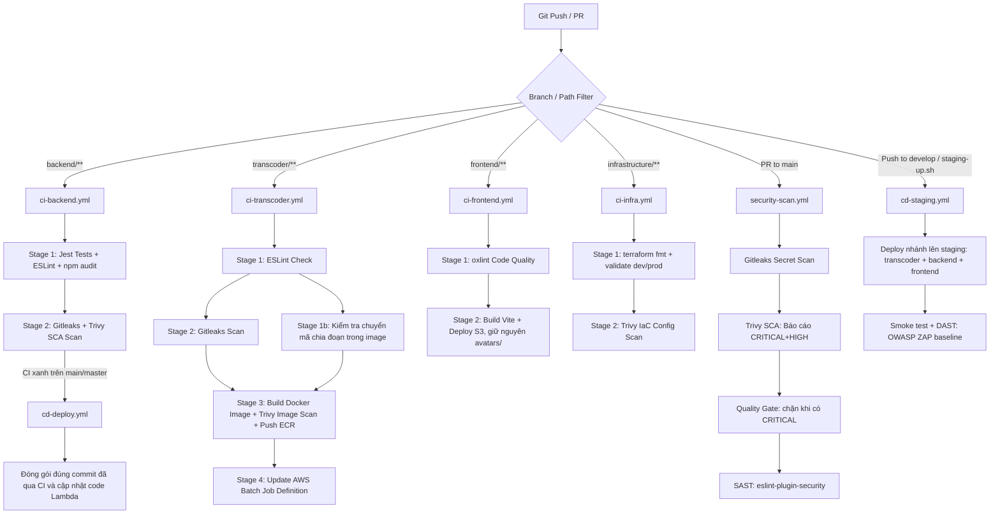

# 🎬 Xây dựng Nền tảng Chia sẻ Video Trực tuyến với Hệ thống Chuyển mã HLS Tự động trên Kiến trúc Serverless Container và Event-Driven
## Building a Video Sharing Platform with Automated HLS Transcoding Pipeline on Serverless Container and Event-Driven Architecture

> **Môn học:** Dự án Công nghệ Thông tin (DACNTT)  
> **Sinh viên thực hiện:**
> - Đinh Quốc Cường (MSSV: 523H0008)
> - Võ Huỳnh Minh Đức (MSSV: 523H0014)
>
> **Giảng viên hướng dẫn:** Thầy ThS. Mai Văn Mạnh  
> **Định hướng chuyên sâu:** DEVOPS, CONTAINERIZATION & CLOUD SYSTEMS  
> **GitHub Repository:** [https://github.com/DinhQuocCuong28664/DACNTT_VideoStreaming](https://github.com/DinhQuocCuong28664/DACNTT_VideoStreaming)  
> **Tên miền ứng dụng (Production Domain):** [https://zelostech.site](https://zelostech.site)

---

## 📋 MỤC LỤC TỔNG QUAN

1. [Tên đề tài](#1-tên-đề-tài)
2. [Thông tin thực hiện](#2-thông-tin-thực-hiện)
3. [Bối cảnh và vấn đề](#3-bối-cảnh-và-vấn-đề)
4. [Mục tiêu của đề tài](#4-mục-tiêu-của-đề-tài)
5. [Các chức năng chính](#5-các-chức-năng-chính)
6. [Quy trình chuyển mã video (Transcoding Pipeline)](#6-quy-trình-chuyển-mã-video)
7. [Phân phối nội dung video (CDN & OAC)](#7-phân-phối-nội-dung-video)
8. [Hạ tầng Cloud-Native và Containerization](#8-hạ-tầng-cloud-native-và-containerization)
9. [CI/CD Pipeline (Tự động hóa Giao tiếp & Triển khai)](#9-cicd-pipeline)
10. [Infrastructure as Code (Quản lý hạ tầng bằng Terraform)](#10-infrastructure-as-code)
11. [Công nghệ dự kiến (Tech Stack)](#11-công-nghệ-dự-kiến)
12. [Phương pháp đánh giá (Performance & QoE Evaluation)](#12-phương-pháp-đánh-giá)
13. [Đóng góp kỹ thuật dự kiến](#13-đóng-góp-kỹ-thuật-dự-kiến)
14. [Sản phẩm dự kiến](#14-sản-phẩm-dự-kiến)
15. [Kết quả dự kiến](#15-kết-quả-dự-kiến)

---

## 1. TÊN ĐỀ TÀI

- **Tiếng Việt:** Xây dựng nền tảng chia sẻ video trực tuyến với hệ thống chuyển mã HLS tự động trên kiến trúc Serverless Container và Event-Driven.
- **Tiếng Anh:** Building a Video Sharing Platform with Automated HLS Transcoding Pipeline on Serverless Container and Event-Driven Architecture.

---

## 2. THÔNG TIN THỰC HIỆN

- **Sinh viên thực hiện:**
  1. Đinh Quốc Cường – MSSV: 523H0008 (Email: `523H0008@student.tdtu.edu.vn`)
  2. Võ Huỳnh Minh Đức – MSSV: 523H0014 (Email: `523H0014@student.tdtu.edu.vn`)
- **Giảng viên hướng dẫn:** ThS. Mai Văn Mạnh
- **Đơn vị công tác:** Khoa Công nghệ Thông tin – Trường Đại học Tôn Đức Thắng (TDTU)

---

## 3. BỐI CẢNH VÀ VẤN ĐỀ

Các nền tảng chia sẻ video hiện đại như YouTube, Vimeo và TikTok đều phải giải quyết một bài toán cốt lõi: khi người dùng tải lên một tệp video gốc có thể sử dụng bất kỳ định dạng, codec hoặc độ phân giải nào, hệ thống phải tự động chuyển mã video sang định dạng **HLS – HTTP Live Streaming**.

Quá trình chuyển mã bao gồm việc chia video thành các đoạn nhỏ có định dạng `.ts`, với thời lượng từ 2 đến 10 giây; tạo nhiều phiên bản chất lượng như **360p, 720p và 1080p**; đồng thời sinh tệp danh sách phát `.m3u8`. Trình phát video trên trình duyệt sử dụng tệp danh sách phát này để tự động chuyển đổi chất lượng video theo băng thông mạng hiện tại của người xem thông qua cơ chế **Adaptive Bitrate Streaming (ABR)**.

Nếu duy trì một cụm máy chủ hoặc hệ thống Kubernetes hoạt động liên tục chỉ để chờ xử lý chuyển mã, hệ thống sẽ phát sinh chi phí tài nguyên nhàn rỗi lớn (Idle Cost) khi không có video được tải lên. Ngược lại, khi nhiều người dùng đồng thời tải video lên, hệ thống cần có khả năng tự động mở rộng để xử lý song song hàng trăm video.

Từ vấn đề trên, đề tài đề xuất xây dựng một nền tảng chia sẻ video hoàn chỉnh dành cho người dùng cuối, kết hợp hệ thống chuyển mã HLS trên kiến trúc **Serverless Container** sử dụng AWS Fargate hoặc AWS Batch với **Event-Driven Architecture**. Kiến trúc này hướng đến giải quyết bài toán tối ưu chi phí vận hành và hỗ trợ tự động mở rộng theo khối lượng xử lý thực tế.

---

## 4. MỤC TIÊU CỦA ĐỀ TÀI

- Đề tài hướng đến xây dựng một nền tảng chia sẻ video trực tuyến cho phép người dùng đăng ký tài khoản, tải video lên, xem video với nhiều mức chất lượng và chia sẻ video thông qua đường dẫn công khai hoặc riêng tư.
- Hệ thống cung cấp quy trình tự động xử lý video từ thời điểm tệp gốc được tải lên Amazon S3 đến khi video được chuyển mã sang HLS, lưu trữ, phân phối qua CDN và sẵn sàng để phát trên trình duyệt.
- Quá trình chuyển mã được thực hiện bằng FFmpeg trong Docker Container chạy trên AWS Batch và AWS Fargate. Container chỉ được khởi tạo khi có nhiệm vụ xử lý và tự động kết thúc sau khi hoàn thành, qua đó hạn chế chi phí tài nguyên nhàn rỗi.
- Đề tài đồng thời hướng đến tự động hóa việc triển khai phần mềm và quản lý hạ tầng thông qua CI/CD Pipeline và Infrastructure as Code.

---

## 5. CÁC CHỨC NĂNG CHÍNH

1. **Đăng ký và đăng nhập:** Hệ thống hỗ trợ người dùng đăng ký và đăng nhập tài khoản. Quá trình xác thực sử dụng JWT Authentication với thời hạn Bearer token an toàn. Sau khi đăng ký, hệ thống gửi một liên kết xác minh email (hiệu lực 24 giờ, dùng một lần, cơ sở dữ liệu chỉ lưu bản băm SHA-256 của token). Tài khoản chưa xác minh vẫn xem, thích và bình luận được nhưng không tải video lên được (`403 EMAIL_NOT_VERIFIED`); có thể gửi lại thư từ thanh nhắc, trang tải lên hoặc Cài đặt. Đăng nhập Google, liên kết Google và đặt lại mật khẩu qua thư đều được tính là đã xác minh. Nếu ai đó đăng ký trước bằng email của người khác, chủ thật của hộp thư nhận lại tài khoản bằng đăng nhập Google hoặc "Quên mật khẩu"; mật khẩu và mọi phiên của người đăng ký trước bị vô hiệu.
2. **Tải video trực tiếp lên Amazon S3 (presigned POST):** Khi người dùng chọn video từ trình duyệt, Frontend gọi Backend API (`POST /api/videos/initiate-upload`) để tạo bản ghi DB trước và nhận một **presigned POST** có thời hạn 15 phút. Tệp video sau đó được tải trực tiếp từ trình duyệt lên Amazon S3 mà không đi qua Backend Server, qua đó giảm tải cho máy chủ Backend. Policy của presigned POST do chính S3 kiểm tra trước khi nhận byte nào: đúng key, đúng `Content-Type` đã kiểm tra và dung lượng từ 1 byte đến mức trần đang áp dụng (mặc định 2 GiB, production 20 GiB; presigned PUT của AWS SDK v3 chỉ ký `host`, nên không ép được hai điều kiện sau). Tệp lớn hơn 512 MiB không dùng một POST duy nhất mà được tải theo từng phần (multipart) 32 MiB: backend mở lượt tải rồi cấp URL ký riêng cho từng phần, mỗi URL ký đúng dung lượng của phần đó nên S3 tự từ chối phần sai kích thước; trình duyệt tải song song 3 phần và thử lại riêng từng phần tối đa 4 lần; trước khi ghép, backend liệt kê các phần S3 đã nhận và chỉ ghép khi đủ phần, đúng dung lượng. Giao diện tích hợp bộ đo telemetry tải lên thời gian thực (tốc độ tải MB/s, thời gian ước tính còn lại ETA, thanh tiến độ phần trăm) và nút Hủy tải lên an toàn (`AbortController` hủy ngay lập tức request tải lên S3, đồng thời kích hoạt hàm `discardDraftVideo()` tự động dọn dẹp bản ghi nháp `UPLOADING` trên MongoDB ở cả 3 nhánh thoát: Hủy tải, Đổi tệp khác, hoặc Lỗi mạng/S3).
3. **Xem video bằng HLS & Trình phát tuỳ biến:** Hệ thống tích hợp thư viện `HLS.js` để phân tích tệp manifest `.m3u8`, tải các đoạn video `.ts` theo thời gian thực và phát nội dung trên trình duyệt. Trình phát được trang bị thanh tua thời gian (timeline scrubber) có tooltip bám theo vị trí con trỏ chuột, hiển thị mốc thời gian tại điểm đang trỏ kèm ảnh xem trước (ảnh bìa cố định, không phải khung hình tại vị trí tua).
4. **Adaptive Bitrate Streaming (ABR):** Trình phát video có khả năng tự động chuyển đổi giữa các mức chất lượng (tối đa sáu mức từ 144p đến 1080p) dựa trên tốc độ mạng hiện tại của người xem, hoặc cho phép người xem chủ động chọn mức chất lượng mong muốn. Các mức được chọn theo kích thước nguồn: không phóng to quá nguồn, giữ nguyên tỉ lệ khung hình (video quay dọc có khung dọc, không đệm viền đen).
5. **Chia sẻ video & Quản lý quyền riêng tư:** Người dùng có thể chia sẻ video thông qua đường dẫn công khai hoặc riêng tư. Quyền riêng tư được kiểm soát đồng bộ ở cả tầng Backend API lẫn tầng CDN Edge Location qua CloudFront Signed Cookies.
6. **Trang cá nhân – Channel Management:** Người dùng có thể quản lý danh sách video đã tải lên, theo dõi trạng thái xử lý — đây là nơi duy nhất thấy được video đang ở `PROCESSING` hoặc `ERROR`, vì trang danh mục công khai chỉ liệt kê video đã `READY` — xem lượt xem, thao tác nhanh qua menu 3 chấm hiện đại: đổi trực tiếp trạng thái hiển thị (Public, Unlisted, Private), mở hộp thoại chỉnh sửa kiểu YouTube Studio (tiêu đề, mô tả, danh mục, visibility; tags hiện chỉ đặt được lúc tải lên), hoặc xóa video (xóa sạch DB record và toàn bộ thư mục HLS trên S3). Danh sách video trên trang kênh sắp xếp được theo Mới nhất / Phổ biến / Cũ nhất (`GET /api/videos/user/:userId?sort=`).
7. **Gợi ý video liên quan (Related Videos) & Tính năng mở rộng:** Hệ thống gợi ý video liên quan (`GET /api/videos/:id/related`) hiển thị ở danh sách "Tiếp theo" bên phải trang xem video, tự động đề xuất dựa trên tag và danh mục tương đồng; thuật toán khoá cứng bộ lọc bảo mật chỉ hiển thị video công khai đã sẵn sàng (`visibility: 'public'` và `status: 'READY'`) đồng thời đóng kín lỗ hổng existence oracle đối với video riêng tư/chưa liệt kê. Bên cạnh đó là các tính năng: Tìm kiếm & lọc video (Search & Filter với regex escaping an toàn), nút Tương tác Like/Dislike, Hệ thống Bình luận (Comments), Đa ngôn ngữ (i18n Tiếng Việt & Tiếng Anh), Phân loại Danh mục (Categories) và Tương thích Responsive Mobile. Giao diện theo bố cục quen thuộc kiểu YouTube: thanh trên với ô tìm kiếm ở giữa, menu trái thu gọn được, lưới thẻ video phẳng cuộn vô hạn, chủ đề sáng / tối / theo thiết bị.
8. **Kiểm duyệt nội dung (Content Moderation):** Ngay trong job chuyển mã, transcoder lấy mẫu khung hình bằng FFmpeg (5 giây/khung, tối đa 120 khung) và gửi tới Amazon Rekognition `DetectModerationLabels`. Video có nội dung khiêu dâm, bạo lực, gây sốc hoặc biểu tượng thù ghét với độ tin cậy ≥ 90% bị **tự động gỡ**; trường hợp lưng chừng (≥ 60%) bị ẩn và **đưa vào hàng rà soát**. Kết quả được ghi cùng một lệnh với `status: READY`, nên không có khoảnh khắc nào video đã công khai mà chưa được kiểm duyệt. Người xem có nút **Báo cáo** với 8 lý do; chủ video bị gỡ có nút **Khiếu nại** (một lần cho mỗi quyết định). Đội vận hành làm việc tại trang `/admin` với ba vai trò, mỗi tab chỉ hiện với vai trò có quyền: **operator** rà soát hàng chờ (ảnh bìa làm mờ mặc định, nhãn Rekognition kèm mốc thời gian, danh sách báo cáo), giữ lại hoặc gỡ video kèm **mã lý do bắt buộc** và ghi chú gửi chủ video, xử lý khiếu nại và gán nhãn kiểm tra mẫu, nhưng không thấy email chủ video và không lật được quyết định của admin; **auditor** chỉ đọc số liệu và nhật ký quyết định; **admin** toàn quyền, gồm cấp vai trò (không tự đổi vai trò của mình, không hạ admin cuối cùng) và lấy mẫu kiểm tra. Kết luận của máy được chụp lại (`autoStatus`) trước khi người ghi đè và mỗi quyết định ghi vào nhật ký chỉ-thêm, nên hệ thống đo được **false positive** (máy gỡ, người khôi phục) và **false negative**: tỉ lệ bỏ lọt chỉ ước lượng từ mẫu ngẫu nhiên các video máy đã duyệt (báo cáo của người xem lệch về phía video nổi tiếng), luôn kèm khoảng tin cậy Wilson 95% và mẫu số. Admin đầu tiên được cấp bằng `node backend/scripts/set-role.js <email> admin`; các vai trò còn lại cấp ở tab Đội ngũ. Chi tiết thiết kế xem tại [`docs/CONTENT_MODERATION.md`](docs/CONTENT_MODERATION.md).

---

## 6. QUY TRÌNH CHUYỂN MÃ VIDEO

Hệ thống áp dụng **Event-Driven Architecture** để tự động kích hoạt quy trình xử lý sau khi video được tải lên.

```mermaid
sequenceDiagram
    autonumber
    actor User as User (Browser)
    participant S3Raw as S3 Raw Bucket
    participant SQS as SQS Queue
    participant Lambda as Lambda Submitter
    participant Batch as AWS Batch (Fargate)
    participant S3Proc as S3 Processed Bucket
    participant DB as MongoDB Atlas

    User->>S3Raw: Upload video gốc (presigned POST, hoặc multipart từng phần 32 MiB cho tệp trên 512 MiB; S3 ép key, Content-Type, dung lượng)
    S3Raw-->>SQS: Trigger Event Notification (s3:ObjectCreated)
    SQS-->>Lambda: Poll Message & Trigger Lambda
    Lambda->>Batch: SubmitJob (với VIDEO_ID & RAW_S3_KEY)
    activate Batch
    Batch->>DB: Cập nhật status = PROCESSING
    alt Video dưới 5 phút: một job
        Batch->>S3Raw: Download video gốc
        Batch->>Batch: Transcode FFmpeg (tối đa sáu mức 144p đến 1080p theo nguồn, .ts 6s, master.m3u8, thumbnail)
    else Video từ 5 phút: chia đoạn song song
        Batch->>Batch: Planner nộp 2 job âm thanh, mảng job chunk (hàng đợi ưu tiên thấp) và job ghép
        Batch->>S3Raw: Mỗi chunk đọc đoạn của mình qua HTTP Range và mã hoá mọi mức
        Batch->>Batch: Job ghép: playlist, BANDWIDTH đo thật, thumbnail, kiểm duyệt
    end
    Batch->>S3Proc: Upload toàn bộ HLS files & thumbnail
    Batch->>DB: Cập nhật status = READY, duration, hlsUrl, thumbnailUrl
    deactivate Batch
    Batch-->>Batch: Container tự động terminate (Fargate scale về 0)
```

### Chi tiết 10 Bước Chuyển mã:
1. Khi tệp video gốc được tải thành công lên S3 Raw Bucket, Amazon S3 tự động phát ra **Event Notification**.
2. Sự kiện được chuyển vào **Amazon SQS**. SQS đóng vai trò Message Queue và bộ đệm nhằm bảo đảm các nhiệm vụ xử lý không bị mất khi có hàng trăm video được tải lên cùng thời điểm.
3. Amazon SQS kích hoạt AWS Batch chạy trên AWS Fargate thông qua Lambda Job Submitter. AWS Batch tự động tạo Docker Container chứa FFmpeg, tải video gốc từ Amazon S3 và thực hiện quá trình chuyển mã. Với video từ 5 phút trở lên, job đầu tiên không mã hoá mà đóng vai trò lập kế hoạch, rồi nộp tiếp các job con để chia việc chạy song song (xem mục 6.1).
4. Video được chuyển sang định dạng HLS và chia thành các đoạn `.ts` có thời lượng 6 giây.
5. Hệ thống tạo tối đa sáu phiên bản chất lượng (8-bit 4:2:0, để nguồn 10-bit HDR hay 4:4:4 vẫn chuyển mã được):
   - **144p** với bitrate 120 kbps;
   - **240p** với bitrate 240 kbps;
   - **360p** với bitrate 400 kbps;
   - **480p** với bitrate 750 kbps;
   - **720p** với bitrate 1,5 Mbps;
   - **1080p** với bitrate 4 Mbps.

   Mỗi mức co nguồn vào khung của nó mà không phóng to: nguồn 480p cho ra 360p và một mức ở đúng 854x480 thay vì một bản "1080p" phóng to 2,25 lần. Kết quả HLS được tải lên S3 song song 8 tệp một lúc. Đường một-job cho video dài hơn 20 phút (nay chỉ còn dùng khi không chia đoạn được) giữ thang rút gọn 360p, 720p và 1080p.
6. Sau đó, hệ thống sinh Master Playlist có định dạng `.m3u8`, trong đó liệt kê các phiên bản chất lượng khả dụng. HLS.js sử dụng Master Playlist để xác định các mức chất lượng có thể phát.
7. Khi quá trình chuyển mã hoàn tất, toàn bộ tệp segment `.ts` và manifest `.m3u8` được tải lên S3 Processed Bucket.
8. Các thông tin metadata gồm tiêu đề, mô tả, URL của manifest, thumbnail và thời lượng video được lưu vào MongoDB Atlas.
9. Docker Container tự động bị hủy sau khi hoàn thành nhiệm vụ. Hệ thống chỉ phát sinh chi phí cho khoảng thời gian container thực sự thực thi quá trình chuyển mã.
10. Chống xử lý trùng và chống kẹt trạng thái: Lambda xoá message SQS ngay khi nộp job, nên việc thử lại nằm ở `retry_strategy` của AWS Batch (chỉ thử lại lỗi hạ tầng như mất Spot capacity). Mọi lần ghi của transcoder đều có điều kiện (không bao giờ ghi đè video đã `READY`), và một bộ đối soát định kỳ trong backend đưa video kẹt ở `PROCESSING` quá 6 giờ hoặc bản nháp `UPLOADING` bỏ dở quá 1 ngày về trạng thái đúng. (Cơ chế Heartbeat gia hạn `VisibilityTimeout` chỉ dùng ở chế độ `worker` chạy tay của transcoder, không nằm trên đường chạy production. Riêng đường chia đoạn có một heartbeat khác: các job con định kỳ ghi lại mốc `updatedAt` của video đang `PROCESSING`, để bộ đối soát không đánh nhầm một video dài là bị kẹt.)

### 6.1 Chuyển mã chia đoạn song song cho video dài

Một job FFmpeg 1 vCPU chạy chậm hơn thời gian thực khoảng 5 lần, nên một video dài sẽ vượt giới hạn thời gian 7.200 giây của một job và bị bộ đối soát đánh lỗi. Vì vậy video từ 5 phút trở lên (ngưỡng là biến Terraform `chunk_threshold_seconds`, hiện là 300 giây) đi đường chia đoạn. Job do Lambda nộp trở thành job lập kế hoạch: nó đọc cấu trúc của nguồn qua HTTP, chia video thành các đoạn có độ dài là bội số nguyên của GOP 6 giây, rồi nộp ba loại job con vào cùng AWS Batch. Hai job âm thanh (64 kbps và 128 kbps, mỗi bitrate được mã hoá đúng một lần cho cả video), một mảng job (Batch array job) mà mỗi phần tử mã hoá một đoạn ở mọi mức chất lượng, và một job ghép chỉ chạy khi mọi đoạn đã xong. Job ghép nối các playlist, đo BANDWIDTH thật từ các segment, tạo thumbnail, chạy kiểm duyệt rồi đặt trạng thái `READY`.

Mảng đoạn được đưa vào một hàng đợi ưu tiên thấp dùng chung môi trường Fargate Spot với hàng đợi chính, nên video ngắn nộp sau không phải chờ hết một video dài. Mỗi đoạn chạy trên task 4 vCPU, và số đoạn được chọn theo số chỗ chạy được cùng lúc (khoảng ba đoạn cho mỗi chỗ, nhỏ nhất khoảng một phút). Khi nguồn không thể chia an toàn (khung hình biến thiên, không biết thời lượng, hình và tiếng lệch nhau quá 0,25 giây), pipeline tự lùi về đường một-job.

Với cùng một video 1080p dài 25 phút ở hạn mức 8 vCPU Fargate Spot, đường một-job cần khoảng 132 phút (ước tính theo 5,3 lần thời gian thực, vượt giới hạn của một job). Cấu hình chia đoạn ban đầu (5 đoạn, task 1 vCPU) mất 36 phút 16 giây từ lúc tải xong đến `READY` (đo trên production), và cấu hình hiện tại mất 20 phút 23 giây (đo trên staging). Video 5 phút mất 26,7 phút ở đường một-job so với 11,9 phút ở đường chia đoạn; video 4 giờ mất 3 giờ 5 phút (đo với task 1 vCPU). Chi tiết và phương pháp đo xem [`docs/CHUNKED_TRANSCODING_DESIGN.md`](docs/CHUNKED_TRANSCODING_DESIGN.md) mục 10.

---

## 7. PHÂN PHỐI NỘI DUNG VIDEO

- Hệ thống sử dụng **Amazon CloudFront** làm Content Delivery Network (CDN) và đặt phía trước S3 Processed Bucket.
- CloudFront lưu các tệp segment `.ts` tại những Edge Location gần người xem, qua đó giảm độ trễ và giảm chi phí truy xuất trực tiếp từ Amazon S3.
- Hệ thống cấu hình **Origin Access Control (OAC)** để S3 Bucket được đặt ở chế độ hoàn toàn riêng tư. Chỉ Amazon CloudFront được cấp quyền truy cập dữ liệu trong bucket (thông qua S3 Bucket Policy), qua đó ngăn chặn việc truy cập trực tiếp trái phép vào video.
- Đối với video ở chế độ riêng tư, hệ thống bổ sung lớp bảo vệ thứ hai bằng **CloudFront Signed Cookies** kết hợp **Trusted Key Group**. Backend kiểm tra quyền truy cập rồi ký một Custom Policy giới hạn trong đúng thư mục của video, nhờ đó người không có quyền sẽ nhận HTTP 403 ngay tại Edge Location kể cả khi biết chính xác đường dẫn tệp `.m3u8`. Chi tiết thiết kế và hướng dẫn triển khai xem tại [`docs/PRIVATE_VIDEO_SIGNED_COOKIES.md`](docs/PRIVATE_VIDEO_SIGNED_COOKIES.md).

- Các segment còn được **mã hoá AES-128** theo RFC 8216 (một khoá cho mỗi video, ở cả đường một job lẫn đường chia đoạn). Playlist trỏ tới `https://api.zelostech.site/api/videos/:id/key`; backend chỉ trả khoá sau đúng các bước kiểm tra quyền như khi phát (riêng tư, hội viên, đang rà soát), nên lấy được segment mà không có quyền thì cũng không giải mã được.

> ℹ️ **Trạng thái triển khai thực tế (cập nhật 2026-09-09):** CloudFront Distribution cho video CDN đã deploy và đang chạy trên production. Tài khoản AWS chính (lưu S3/Batch/Lambda) vẫn bị chặn tự tạo CloudFront Distribution (`AccessDenied: Your account must be verified`), nên CloudFront được vận hành trên một AWS account phụ thông qua cơ chế Terraform multi-account provider — S3 Processed Bucket vẫn ở account chính và hoàn toàn riêng tư qua Origin Access Control. **Signed Cookies nay đã bật** (`enable_signed_urls = true`, Trusted Key Group gắn từ 2026-08-30): mọi request video không kèm cookie hợp lệ đều nhận HTTP 403 `MissingKey` ngay tại Edge Location. Cổng ký này phủ toàn bộ video kể cả video công khai; riêng `*/thumbnail.jpg` được cố ý miễn trừ để trang danh mục vẫn hiển thị được ảnh đại diện. Xem Chương 6 của báo cáo (`report/chapters/chap6.tex`) để biết phân tích đầy đủ.

---

## 8. HẠ TẦNG CLOUD-NATIVE VÀ CONTAINERIZATION

- Môi trường xử lý video gồm FFmpeg và Node.js được đóng gói thành Docker Image.
- Docker Image được tối ưu thông qua **Multi-stage Build** (Base image: `node:24-slim`; FFmpeg 8.1.2 là bản dựng tĩnh của `mwader/static-ffmpeg`, ghim theo digest và sao chép vào image thay vì cài bằng apt, vì các phiên bản FFmpeg khác nhau cho kết quả khác nhau ở ranh giới giữa các đoạn) nhằm giảm kích thước image và hạn chế các thành phần không cần thiết trong môi trường thực thi. Phiên bản Node.js đã trải qua 2 lần nâng cấp: từ `node:18-slim` lên `node:20-slim` do Mongoose 9.x phụ thuộc vào Web Crypto API vốn chưa khả dụng đầy đủ trên Node.js 18; và từ `node:20-slim` lên `node:24-slim` (10/8/2026) vì Node.js 20 đã hết vòng đời hỗ trợ (EOL 30/4/2026, không còn nhận bản vá bảo mật). Chọn Node 24 vì đây là bản Active LTS (hỗ trợ đến 4/2028), ổn định hơn cho production so với bản Current (Node 26, chưa vào LTS tại thời điểm nâng cấp).
- Sau khi được xây dựng, Docker Image được đưa lên **Amazon Elastic Container Registry (ECR)** để AWS Batch sử dụng khi khởi tạo các tác vụ chuyển mã.
- AWS Batch chạy trên **AWS Fargate** (hỗ trợ `FARGATE_SPOT` ở môi trường Dev giúp tiết kiệm 70% chi phí) chịu trách nhiệm quản lý các tác vụ xử lý video. Hệ thống có khả năng tự động tạo thêm container khi số lượng nhiệm vụ tăng và kết thúc container khi nhiệm vụ hoàn thành.

### 8.1 Backend API serverless (AWS Lambda)

Từ 2026-10-26 backend Express không còn chạy trên máy EC2 mà chạy trên **AWS Lambda** (`dacntt-dev-backend-api`, Node.js 22, 512 MB) qua `@codegenie/serverless-express`; máy EC2 cũ đã tắt.

- **Đường đi của request:** trình duyệt gọi `https://api.zelostech.site`, một **Cloudflare Worker** (`infrastructure/cloudflare-worker`) chuyển tiếp tới **Lambda Function URL**. Function URL chỉ cho phép gọi `lambda:InvokeFunction` khi đi qua chính nó (điều kiện `lambda:InvokedViaFunctionUrl`).
- **Secret:** cấu hình hàm chỉ chứa ARN (`MONGODB_URI_SECRET_ARN`, `JWT_SECRET_SECRET_ARN`, ...). Khi một execution environment khởi động, backend đọc giá trị từ **AWS Secrets Manager** rồi mới kết nối MongoDB (`backend/src/config/runtimeSecrets.js`), nên không secret nào nằm dạng chữ trong cấu hình Lambda.
- **Trạng thái dùng chung giữa các instance:** bộ giới hạn tốc độ (`express-rate-limit`) và bộ chống đếm trùng lượt xem lưu trong MongoDB (`ratelimithits`, `viewmarks`, có TTL index) thay vì RAM, vì mỗi instance Lambda có bộ nhớ riêng.
- **Bộ đối soát định kỳ:** EventBridge gọi cùng hàm mỗi giờ; handler nhận sự kiện lịch và chạy bộ đối soát video kẹt thay vì chuyển cho Express.
- **Chi phí lúc rảnh:** không có máy chạy liên tục; Lambda chỉ tính tiền theo lượt gọi.

---

## 9. CI/CD PIPELINE

CI/CD Pipeline được xây dựng bằng **GitHub Actions** với 7 Workflows tách biệt tuân thủ DevSecOps Quality Gate:



### Các Workflows Chính:
1. `ci-backend.yml`: Chạy Jest Unit Tests (648 test trên 52 test suites, 2026-10-28) → ESLint check → Gitleaks secret detection → Trivy SCA scan.
2. `ci-transcoder.yml`: Chạy Jest Unit Tests (385 test trên 19 test suites, 2026-10-28) → ESLint check → Gitleaks → kiểm tra ranh giới đoạn bằng FFmpeg thật bên trong chính image (Stage 1b) → Build Docker Multi-stage → Trivy Container Scan → Push ECR (tag SHA; tag `:latest` chỉ dời khi build từ `master`) → Register AWS Batch Job Definition mới với image tag SHA. Terraform không tự đổi image: khi apply, nó đọc image của revision đang chạy.
3. `ci-frontend.yml`: oxlint Code Quality → Build Vite → Tự động deploy lên S3 Static Hosting khi merge vào `main`/`master` (`s3 sync --delete` loại trừ `avatars/`, nơi chứa ảnh đại diện người dùng tải lên) → Invalidate cache CloudFront của frontend.
4. `ci-infra.yml`: `terraform fmt -check` → `terraform validate` cho cả `dev` và `prod` → Trivy IaC Config Scan.
5. `security-scan.yml`: DevSecOps Gate cho mọi Pull Request, gồm Gitleaks Secret Detection, Trivy Dependency Scan và SAST bằng `eslint-plugin-security`.
6. `cd-staging.yml`: Deploy một nhánh lên môi trường **staging** (xem mục "Môi trường Staging" bên dưới) khi có push vào `develop` hoặc khi `scripts/staging-up.sh` kích hoạt: build image transcoder (tag SHA) và đăng ký job definition staging → deploy backend lên Lambda `dacntt-staging-backend-api` (cùng cách `cd-deploy.yml` làm với production) → build frontend trỏ tới API staging → smoke test → quét DAST bằng OWASP ZAP baseline (chỉ báo cáo).
7. `cd-deploy.yml`: Chạy sau khi `CI — Backend` **thành công** trên `main`/`master` (sự kiện `workflow_run`). Workflow lấy đúng commit CI vừa kiểm, đóng gói backend bằng Node 24 (`npm ci --omit=dev`, cùng phiên bản npm đã ghi lockfile), gọi `aws lambda update-function-code` cho `dacntt-dev-backend-api`, chờ hàm cập nhật xong rồi kiểm tra `/health`. Terraform bỏ qua phần code của hàm (`ignore_changes`), nên CD là nơi duy nhất thay code; cấu hình (biến môi trường, quyền) vẫn do Terraform quản lý. Workflow này không invalidate CDN video vì nội dung HLS là bất biến.

Các workflow truy cập AWS bằng **OIDC** (role tạm thời trong `infrastructure/environments/dev/github-oidc.tf`, mỗi nhóm job một role với quyền tối thiểu) qua các biến repository `AWS_ECR_PUSH_ROLE_ARN`, `AWS_DEPLOY_ROLE_ARN`, `AWS_CLOUDFRONT_ROLE_ARN` và hai biến staging `AWS_STAGING_DEPLOY_ROLE_ARN`, `AWS_STAGING_CLOUDFRONT_ROLE_ARN` (bật ngày 2026-10-03). GitHub Secrets không còn khoá AWS tĩnh nào. Environment `production` trên GitHub chỉ cho phép nhánh `master` (Settings → Environments → Deployment branches, đặt ngày 2026-09-29): role deploy tin mọi job gắn `environment: production`, nên không có quy tắc này thì một workflow ở nhánh bất kỳ cũng lấy được quyền deploy production.

### Môi trường Staging

Staging (`infrastructure/environments/staging`) là bản sao thu gọn của production để thử một nhánh trước khi merge: `https://staging.zelostech.site`, API `https://api-staging.zelostech.site`, CDN video `cdn-staging.zelostech.site`. Nó có database riêng (`vidshare-staging` trên cùng cluster Atlas), JWT secret và cặp khoá ký CloudFront riêng; dùng chung với production repo ECR, mật khẩu Gmail và token Cloudflare.

Backend staging chạy trên Lambda như production (`backend-lambda.tf`): hàm `dacntt-staging-backend-api` sau Worker `zelostech-api-gateway-staging` (`wrangler deploy --env staging` trong `infrastructure/cloudflare-worker`). Không còn máy chủ phải bật hay tắt, nên cũng không còn `staging-down.sh`:

```bash
bash scripts/staging-up.sh <nhánh>   # terraform apply rồi kích hoạt cd-staging.yml cho nhánh đó
# ... thử trên https://staging.zelostech.site ...
```

Quy trình phát hành: `staging-up.sh <nhánh>` → thử → merge vào `master` (`cd-deploy.yml` đưa đúng commit đó lên production sau khi CI xanh).

Chi phí: lúc rảnh chỉ còn các secret riêng của staging (khoảng $0,40/tháng mỗi secret); Lambda, S3, SQS, Batch và CloudFront không tính phí khi không có lưu lượng. Mỗi lượt thử tốn thêm phần Fargate Spot và Rekognition của các video tải lên.

Lần đầu: secret `dacntt-staging/origin-verify-secret` phải có giá trị, và cùng giá trị đó phải nằm trong Worker staging (`wrangler secret put ORIGIN_VERIFY_SECRET --env staging`), vì hàm không khởi động được khi secret rỗng; `TARGET_HOST` của `[env.staging]` trong `wrangler.toml` là host của `terraform output backend_function_url`.

Lưu ý:
- Apply `environments/dev` trước (staging đọc OIDC provider và secret dùng chung do dev tạo).
- Đăng nhập Google chỉ chạy trên staging sau khi thêm `https://staging.zelostech.site` vào *Authorized JavaScript origins* của OAuth client trên Google Cloud Console.

### Cơ chế Quality Gate hai lớp

Mỗi bước quét bảo mật được tách thành hai lớp có vai trò khác nhau. Lớp **Báo cáo** quét ở mức `CRITICAL,HIGH` với `exit-code: 0`, có nhiệm vụ cung cấp bức tranh đầy đủ về hiện trạng lỗ hổng mà không làm gián đoạn quy trình phát triển. Lớp **Quality Gate** chỉ quét ở mức `CRITICAL` nhưng đặt `exit-code: 1`, khiến pipeline thất bại và Pull Request không thể được merge.

Cách phân tách này xuất phát từ thực tế vận hành: phần lớn lỗ hổng mức `HIGH` nằm ở các thư viện phụ thuộc gián tiếp và thường chưa có bản vá, nếu chặn toàn bộ thì pipeline sẽ liên tục thất bại vì những nguyên nhân nhóm phát triển không thể xử lý. Ngược lại, lỗ hổng `CRITICAL` đã có bản vá (`--ignore-unfixed`) là thứ bắt buộc phải khắc phục trước khi đưa mã nguồn vào nhánh chính.

---

## 10. INFRASTRUCTURE AS CODE

Toàn bộ hạ tầng AWS được quản lý bằng **Terraform** theo phương pháp Infrastructure as Code (IaC) chia thành 14 modules độc lập:

| Module | Đường dẫn | Chức năng chính |
|---|---|---|
| `s3` | `infrastructure/modules/s3` | Raw & Processed S3 Buckets, CORS, Glacier Lifecycle (30 ngày), S3 Event Notification |
| `sqs` | `infrastructure/modules/sqs` | Transcode Queue (Visibility 300s) + Dead Letter Queue (DLQ) + Queue Policy |
| `ecr` | `infrastructure/modules/ecr` | Image Scanning on Push, Image Lifecycle Policy (giữ 5 images mới nhất) |
| `iam` | `infrastructure/modules/iam` | IAM Roles: Batch Service, ECS Task Exec, Transcoder Task, Lambda Submitter, Lambda Backend |
| `vpc` | `infrastructure/modules/vpc` | VPC (10.0.0.0/16), 2 Public Subnets, IGW, Security Groups, S3 VPC Gateway Endpoint |
| `secrets` | `infrastructure/modules/secrets` | AWS Secrets Manager lưu `mongodb-uri`, `jwt-secret`, `email-app-password`, `cloudfront-private-key`, `cloudflare-api-token` |
| `sns` | `infrastructure/modules/sns` | SNS Notification Topics (`transcode-complete`, `dlq-alert`) + Email Subscriptions |
| `monitoring` | `infrastructure/modules/monitoring` | CloudWatch Log Groups, Alarms (DLQ Depth > 0), CloudWatch Dashboard |
| `batch` | `infrastructure/modules/batch` | Fargate Compute Environment (SPOT/ON_DEMAND), hai Job Queue (chính và ưu tiên thấp cho các chunk), Job Definition |
| `lambda` | `infrastructure/modules/lambda` | Lambda Job Submitter (Node.js 22), SQS Event Source Mapping trigger |
| `lambda-backend` | `infrastructure/modules/lambda-backend` | Backend API trên Lambda (Node.js 22): Function URL, quyền gọi qua Function URL, log group, lịch EventBridge cho bộ đối soát; secret truyền bằng ARN |
| `cloudfront` | `infrastructure/modules/cloudfront` | CloudFront Distribution, Origin Access Control (OAC), HLS Cache Policy |
| `backend-userdata` | `infrastructure/modules/backend-userdata` | Dựng chuỗi user-data của EC2 backend từ `scripts/ec2-userdata.sh` (không tạo tài nguyên) |
| `cloudflare-ips` | `infrastructure/modules/cloudflare-ips` | Dải IPv4 của Cloudflare cho security group của backend (không tạo tài nguyên) |

Hệ thống phân tách môi trường rõ ràng giữa `infrastructure/environments/dev` và `infrastructure/environments/prod`, hỗ trợ khởi tạo toàn bộ hạ tầng thông qua một lệnh `terraform apply`.

---

## 11. CÔNG NGHỆ DỰ KIẾN

- **Frontend:** React.js (Vite), HLS.js, Axios, React Router v6, Lucide/Feather Icons.
- **Backend API:** Node.js, Express.js trên AWS Lambda (`@codegenie/serverless-express`) sau Cloudflare Worker, JWT Authentication, AWS SDK v3 (`@aws-sdk/client-s3`, `@aws-sdk/s3-request-presigner`, `@aws-sdk/client-secrets-manager`).
- **Xử lý video (Transcoder Engine):** FFmpeg, Node.js worker, Docker Multi-stage Container trên AWS Batch và AWS Fargate.
- **Cloud Infrastructure (AWS):** Amazon S3, Amazon SQS, AWS Batch, AWS Fargate, Amazon ECR, Amazon CloudFront (OAC), Amazon SNS, AWS Secrets Manager, Amazon CloudWatch.
- **Cơ sở dữ liệu:** MongoDB Atlas (Mongoose ODM 9.x).
- **DevOps & IaC:** Docker, GitHub Actions, Terraform (AWS Provider v5.x), Jest Testing.

---

## 12. PHƯƠNG PHÁP ĐÁNH GIÁ

1. **Đánh giá trải nghiệm xem video – Quality of Experience (QoE):** Hệ thống đo thời gian từ khi người dùng nhấn nút phát đến khi khung hình đầu tiên xuất hiện, tương ứng với chỉ số **Time-to-First-Frame (TTFF)**. Khả năng chuyển đổi chất lượng video khi băng thông mạng thay đổi được kiểm tra bằng chức năng giới hạn tốc độ mạng (Network Throttling) trong Chrome DevTools.
2. **Đánh giá hiệu năng Transcoding Pipeline:** Hệ thống đo tổng thời gian xử lý từ khi video được tải lên hoàn tất đến khi video sẵn sàng để xem. Thử nghiệm được thực hiện với các tệp có kích thước **100 MB, 500 MB và 1 GB**.
3. **Kiểm thử chịu tải – Stress Test (k6):** Script tự động `scripts/k6-load-test.js` được sử dụng để nộp đồng thời từ **50 đến 100 video** lên Amazon S3. Kết quả được dùng để kiểm chứng khả năng tự động mở rộng của AWS Batch và khả năng lưu giữ các nhiệm vụ chờ xử lý của Amazon SQS.
4. **Phân tích chi phí – FinOps:** Bảng phân tích chi phí `docs/FINOPS_COST_ANALYSIS.md` so sánh chi phí vận hành giữa kiến trúc sử dụng Amazon EC2 chạy FFmpeg liên tục 24 giờ mỗi ngày và kiến trúc Serverless sử dụng AWS Batch trên Fargate (`FARGATE_SPOT`), chứng minh khả năng tiết kiệm từ 80% - 92% chi phí nhàn rỗi.

---

## 13. ĐÓNG GÓP KỸ THUẬT DỰ KIẾN

- Đề tài xây dựng một quy trình xử lý video tự động theo Event-Driven Architecture, bắt đầu từ sự kiện tải video lên Amazon S3 và kết thúc khi video HLS đã được chuyển mã, lưu trữ và phân phối qua CDN.
- Hệ thống tích hợp Amazon SQS làm bộ đệm cho các nhiệm vụ chuyển mã, hỗ trợ duy trì nhiệm vụ chờ xử lý khi có nhiều video được tải lên đồng thời.
- Quá trình chuyển mã được thực hiện bằng FFmpeg trong Serverless Container trên AWS Batch và AWS Fargate. Cách tiếp cận này cho phép hệ thống tự động mở rộng theo số lượng nhiệm vụ và giảm chi phí tài nguyên nhàn rỗi.
- Đề tài xây dựng quy trình tạo nhiều phiên bản chất lượng, Master Playlist và các segment HLS để hỗ trợ Adaptive Bitrate Streaming trên trình duyệt.
- Hạ tầng được chuẩn hóa bằng Terraform và quá trình triển khai được tự động hóa bằng GitHub Actions.

---

## 14. SẢN PHẨM DỰ KIẾN

1. Phân hệ đăng ký và đăng nhập người dùng (JWT Authentication).
2. Chức năng tải video trực tiếp lên Amazon S3 bằng presigned POST, và tải theo từng phần (multipart) cho tệp trên 512 MiB (S3 ép dung lượng và định dạng).
3. Trang cá nhân để quản lý video, xem lượt xem và xóa video.
4. Chức năng chia sẻ video công khai hoặc riêng tư.
5. Trình phát video hỗ trợ HLS và Adaptive Bitrate Streaming (144p đến 1080p).
6. Hệ thống chuyển mã video tự động sang HLS dùng FFmpeg trong Docker Container.
7. Quy trình xử lý sự kiện Event-Driven sử dụng Amazon S3, Amazon SQS, AWS Lambda và AWS Batch.
8. Hệ thống Serverless Container sử dụng AWS Fargate (`FARGATE_SPOT`).
9. Hệ thống phân phối video bảo mật qua Amazon CloudFront (OAC).
10. Docker Image chứa FFmpeg và Node.js (Multi-stage build).
11. CI/CD Pipeline 4 giai đoạn sử dụng GitHub Actions.
12. Bộ mã nguồn Infrastructure as Code 14 modules sử dụng Terraform.
13. Khả năng khởi tạo toàn bộ hạ tầng AWS thông qua một lệnh `terraform apply`.
14. Mã nguồn hoàn chỉnh của toàn bộ hệ thống (Monorepo).
15. Tài liệu phân tích và thiết kế, Báo cáo đánh giá hiệu năng chuyển mã, Kịch bản k6 Load Test và Báo cáo phân tích tối ưu chi phí FinOps.

---

## 15. KẾT QUẢ DỰ KIẾN

- Người dùng có thể đăng ký tài khoản, tải video lên, xem video với nhiều mức chất lượng và chia sẻ video, với trải nghiệm tương tự một nền tảng chia sẻ video trực tuyến chuyên nghiệp.
- Khi video được tải lên, hệ thống tự động kích hoạt Transcoding Pipeline, chuyển video sang HLS với các mức chất lượng từ 144p đến 1080p, lưu dữ liệu đã xử lý, phân phối video qua CDN và đưa video vào trạng thái sẵn sàng để xem.
- Toàn bộ hạ tầng AWS được mô tả và quản lý bằng Terraform, cho phép triển khai hệ thống thông qua một lệnh.
- CI/CD Pipeline tự động hóa các bước từ kiểm tra mã nguồn, chạy unit test, xây dựng Docker Image, cập nhật AWS Batch Job Definition đến triển khai Backend API.
- Đề tài cung cấp báo cáo phân tích hiệu năng chuyển mã và báo cáo so sánh chi phí giữa kiến trúc máy chủ hoạt động liên tục với kiến trúc Serverless Container chỉ tính phí theo thời gian thực thi.
