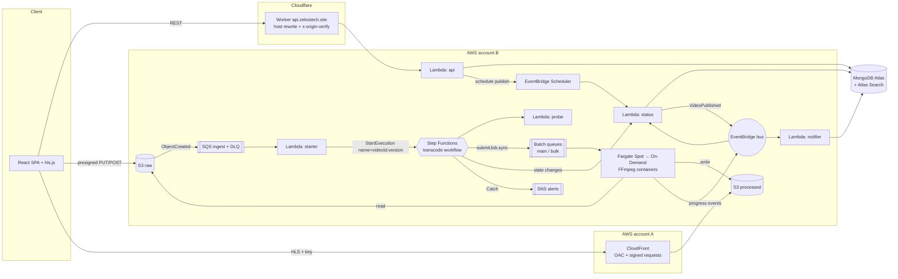
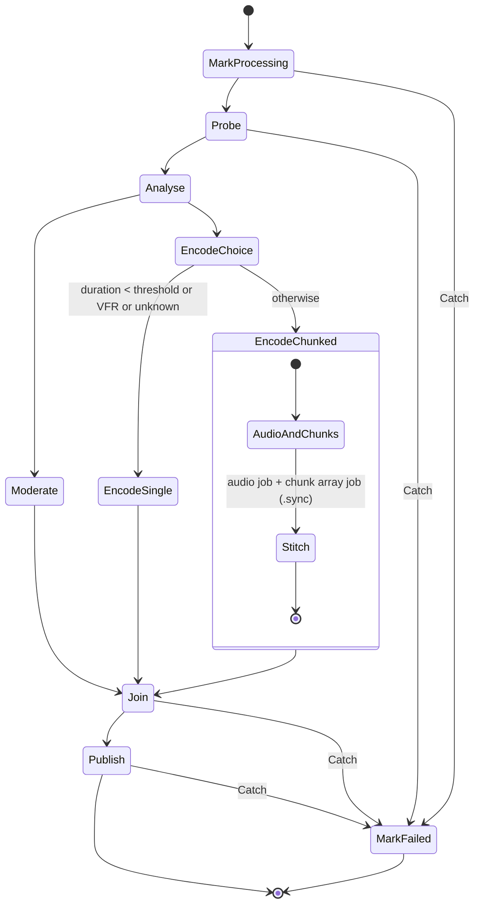
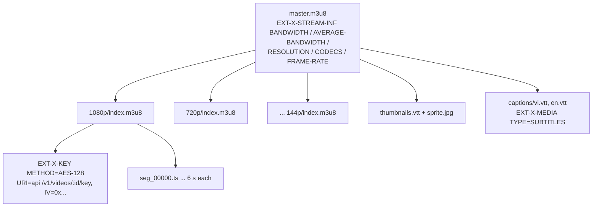
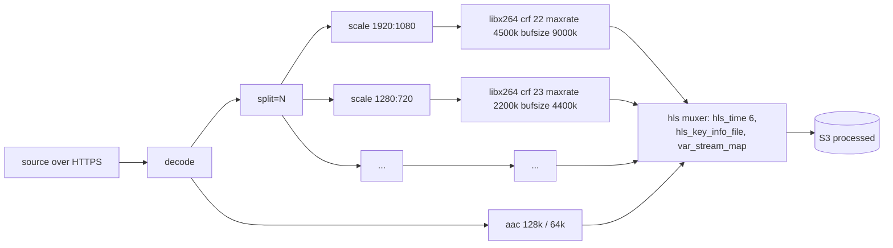
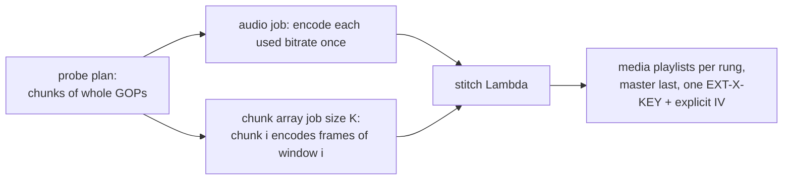
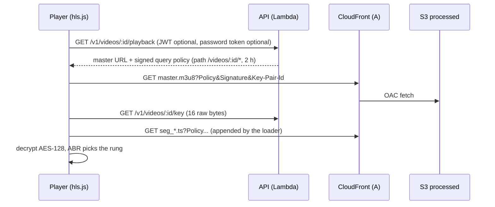
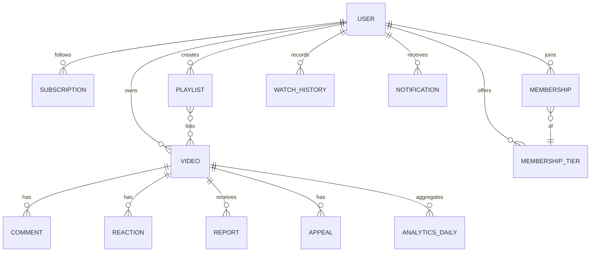

# Architecture — Video Sharing Platform v2

Status: **approved by the owner on 2026-10-28 (S0)**: TypeScript everywhere, resource prefix
`zelos-{env}`, chunk fan-out as one Batch array job, playback authorised by a CloudFront
signed query policy instead of cookies. Branch: `rebuild/v2`.

This document is the design baseline of the rewrite. Code, infrastructure, tests and the
report follow it; when they disagree, this document is fixed first.

## 1. Scope

The platform is a video sharing service in the spirit of YouTube and Vimeo, built on an
event-driven, serverless-container transcoding pipeline. Every feature below is part of the
product; none is optional.

| # | Area | Features |
|---|---|---|
| F1 | Accounts | Register (username, email, password ≥ 8 chars, blocklist, breached-password check), sign in, Google sign-in and account linking, email verification with throttled resend, forgot/reset/change password, sign out, JWT in the `Authorization` header, rate-limited auth routes |
| F2 | Channels | Public profile with subscriber count, `@handle`, avatar (moderated), banner, channel sections, sorted video list |
| F3 | Upload | Direct-to-S3 upload: presigned POST for small files, multipart (32 MiB parts) up to 20 GiB, resumable confirm, progress/speed/ETA/cancel, custom thumbnail |
| F4 | Processing | Event-driven pipeline, six-rung Capped-CRF HLS ladder bounded by the source, 6 s segments, AES-128 per video, thumbnail, seek-preview sprite, long videos split into parallel chunks, moderation and violence labels, per-step progress |
| F5 | Watching | Home feed, Atlas Search (relevance, typo tolerance, diacritic-insensitive, autocomplete), categories, related videos, custom hls.js player (quality/ABR, speed, PiP, fullscreen, captions, chapters, seek preview), resume position, 30-second view rule with dedupe, like/dislike |
| F6 | Sharing & access | Public, unlisted, private, password-protected; members-only audience; embed player `/embed/:id`; share with timestamp; scheduled publishing |
| F7 | Community | Comments, replies (cursor paging), pin, delete, report comment, report video |
| F8 | Subscriptions | Subscribe/unsubscribe, subscription feed, in-app notifications for new uploads (optional email) |
| F9 | Memberships | Tiers per channel, join/cancel (sandbox payment), member roster, members-only videos, member badge |
| F10 | Library | Watch history, watch later, playlists (ordered, public/unlisted/private) |
| F11 | Creator studio | Edit metadata, captions (VTT upload), chapters, thumbnail, visibility, schedule; analytics: views per day, watch time, audience retention |
| F12 | Trust & safety | Automatic screening (Rekognition), review queue, decisions with reason codes, appeals, audit sampling with FP/FN metrics, event log, user/role admin; roles `user`, `operator`, `auditor`, `admin` |
| F13 | UI | Light/dark theme, Vietnamese/English, 403/404 pages, design system in vanilla CSS (no Tailwind) |

Not in scope (owner, 2026-10-28): age restriction, owner download toggle, replace-file-keep-link,
autoplay/up-next queue.

## 2. Constraints

| Constraint | Value (measured 2026-10-28) | Consequence |
|---|---|---|
| AWS account B (`749680934725`, `ap-southeast-1`) | All compute and storage | Credits; Fargate only, no always-on instances |
| AWS account A (`911707244328`) | CloudFront + ACM only (B may not create CloudFront) | Cross-account OAC/bucket policy; new paid resources need the owner's OK |
| Fargate quota | 8 vCPU Spot + 8 vCPU On-Demand (Spot 12 requested) | Transcoding ceiling 16 vCPU |
| Lambda concurrency | 400 per account (1000 requested) | Reserved concurrency per function (§5.8) |
| Batch `SubmitJob` | 50 TPS | Chunk fan-out uses one array job, not one call per chunk |
| MongoDB Atlas | Free tier, MongoDB 8.0, **500 connections**, **3 search indexes**, 512 MB storage | Connection budget (§5.8); three search indexes (§5.9) |
| Cloudflare | DNS and the API gateway Worker for `zelostech.site` | API host rewrite, origin-verify secret |
| Email | Gmail SMTP (SES account still in sandbox) | Recipient throttle, never block registration on mail failure |
| Old stack `dacntt-dev-*` | Keeps serving until cutover | New resources use a new prefix and never touch it |

## 3. Architecture overview



Principles taken from the AWS Well-Architected Serverless Lens (event sources, routers and
destinations; durable queues; data contracts; tracing) and the AWS "Video on Demand on AWS"
solution (a Step Functions workflow owns the job, every step reports state, failures notify).

## 4. Transcoding workflow

### 4.1 Ingest and idempotency

1. `POST /v1/uploads` creates the video in state `UPLOADING` and returns a presigned POST
   (≤ 5 GiB) or a multipart session. The POST policy and every part pin the key
   `raw/{videoId}/{uploadVersion}/source` and the metadata `x-amz-meta-video-id`,
   `x-amz-meta-upload-version`, `x-amz-meta-owner-id`.
2. S3 `ObjectCreated` on `raw/` goes to the ingest SQS queue (DLQ after 3 receives).
3. Lambda `starter` reads the object metadata (never parses the key), validates it against the
   shared event schema, and calls `StartExecution` with `name = {videoId}-{uploadVersion}`.
   `ExecutionAlreadyExists` counts as success, so duplicate S3 events start nothing new. It uses
   SQS partial batch responses.

### 4.2 State machine



| State | Runs on | Output |
|---|---|---|
| MarkProcessing | Lambda `status` | Video → `PROCESSING`, step `probe` |
| Probe | Lambda `probe` (static ffprobe layer, reads the source over a presigned HTTPS URL) | Streams, display size (rotation, SAR), fps from `avg_frame_rate`, VFR flag, A/V start offset, duration, rendition plan, chunk plan |
| Moderate | Batch job `moderate` (0.5 vCPU) | Sampled frames → Rekognition `DetectModerationLabels` → decision + violence labels |
| EncodeSingle | Batch job `encode` (1–4 vCPU) | All renditions, HLS, AES-128, CODECS, measured BANDWIDTH, thumbnail, sprite |
| EncodeChunked | Batch job `audio` + array job `chunk` (4 vCPU, bulk queue) + Lambda `stitch` | Same outputs, assembled from chunks |
| Publish | Lambda `status` | Master playlist written last, video → `READY` (or `SCHEDULED`), event `VideoPublished` |
| MarkFailed | Lambda `status` | Video → `ERROR` with reason, owner notified once, SNS alert, temporary files removed |

Retries: Batch jobs retry on Spot reclaim (`retryStrategy` evaluates `Host EC2*`/task stopped);
Lambda tasks retry `Lambda.ServiceException` and throttling with backoff. A workflow
`TimeoutSeconds` (10 h) replaces the hourly "stuck PROCESSING" sweep.

Progress: containers publish `TranscodeProgress` events (at most one every 5 s per job) to the
EventBridge bus; `status` stores `processingProgress` and the current step. The chunked path
reports the share of finished chunks.

### 4.3 Compute

- One container image, one job definition per role (`moderate`, `encode`, `audio`, `chunk`),
  `node:22-slim` plus a pinned static FFmpeg.
- Compute environments: Fargate Spot (max 8 vCPU) first, Fargate On-Demand (max 8 vCPU) second,
  shared by two queues: `main` (priority 10: probe-sized and single jobs) and `bulk` (priority 1:
  chunk arrays), so short videos overtake long ones.
- Containers only read from S3 raw and write to S3 processed. They have **no database
  credentials**; their role allows `s3:GetObject` on raw, `s3:PutObject` on processed,
  `events:PutEvents` on the bus and `rekognition:DetectModerationLabels`.

## 5. Media design

### 5.1 HLS output



- Segment target 6 s, `EXT-X-TARGETDURATION` = rounded longest segment, `EXT-X-INDEPENDENT-SEGMENTS`.
- `BANDWIDTH` is the measured peak segment bitrate rounded up; `AVERAGE-BANDWIDTH` is total
  bytes over total seconds (RFC 8216 §4.3.4.2).
- `CODECS` comes from the SPS of the first real segment (`avc1.PPCCLL`) plus `mp4a.40.2`; the
  attribute is omitted rather than guessed when it cannot be read.
- Captions are WebVTT subtitle renditions; chapters are stored on the video and shown by the player.

### 5.2 FFmpeg filter graph (single job)



Rules every rendition shares (so ABR switches never break): forced keyframes at absolute 6 s
marks, `-g` from the real frame rate and `-keyint_min` equal to it (closed GOP),
`-sc_threshold 0`, 8-bit 4:2:0 (`yuv420p`), `profile` set but no `-level`, even dimensions,
source read once.

### 5.3 Bitrate ladder

| Rung | CRF | maxrate | bufsize | Audio |
|---|---|---|---|---|
| 144p | 28 | 180k | 360k | 64k |
| 240p | 26 | 350k | 700k | 64k |
| 360p | 25 | 600k | 1200k | 64k |
| 480p | 24 | 1100k | 2200k | 64k |
| 720p | 23 | 2200k | 4400k | 128k |
| 1080p | 22 | 4500k | 9000k | 128k |

Rungs are bounded by the source: no upscaling, a source between rungs gets a rung at its own
size, portrait sources use portrait frames without padding, rotation flags and non-square SAR
are applied before planning. Videos over the long-video threshold use the 360p/720p/1080p
subset on the single-job path; the chunked path always gets the full ladder. The rationale and
references (Apple HLS Authoring Specification, x264 CRF/VBV, FFmpeg HLS muxer) belong in
ADR-09.

### 5.4 Long videos (chunked path)



Invariants (from the measured design): chunk windows meet exactly; seek half a frame before the
first frame; chunk 0 never seeks negative; the last chunk is open-ended; audio windows match to
the microsecond; a remainder shorter than one GOP joins the previous chunk; segment boundaries
must align across rungs (RFC 8216 §6.2.4) and a chunk that differs from plan by more than
0.25 s or 3 frames fails the stitch. Chunk size adapts to capacity (about three chunks per
available slot, never below the minimum); a 4-hour video stays at 48 chunks of 5 minutes.
Fallback to the single job: VFR source, unknown duration, A/V start offset > 0.25 s, fewer
than two chunks.

### 5.5 Encryption and playback



- One random 16-byte key and an explicit IV per video; the key is stored server-side and is
  served only after the same access check as playback (owner, visibility, password, membership,
  moderation).
- Access to `processed/` uses a CloudFront **custom policy with a wildcard path**, sent as query
  parameters that the hls.js loader appends to every request. Cookies are not used, so the embed
  player works inside third-party iframes where browsers block third-party cookies.
- AES-128 is not DRM: a viewer who may play the video can also reassemble it. Widevine/FairPlay
  is the documented next step.

### 5.6 Adaptive bitrate in the player

hls.js estimates bandwidth (EWMA of segment downloads) and selects the highest rung whose
`BANDWIDTH` fits under the estimate with a safety factor, dropping early when the buffer
falls below its threshold. The player exposes manual quality, stats (bandwidth, buffer,
dropped frames), captions, chapters and the sprite preview.

### 5.7 Moderation

Frames are sampled at a fixed interval (widened for long videos up to a frame cap) and checked
with `DetectModerationLabels`. A shared label policy maps labels to `block`, `review` or
`allow` and sets the violence warning; fictional content lowers severity. Avatars use the same
policy. If Rekognition is unavailable, the video goes to `review` (fail closed).

### 5.8 Concurrency and connection budget

| Function | Reserved concurrency | Mongo pool per instance | Max connections |
|---|---|---|---|
| api (prod) | 80 | 3 | 240 |
| status (prod) | 10 | 2 | 20 |
| notifier, scheduler hooks (prod) | 5 | 2 | 10 |
| api (staging) | 20 | 3 | 60 |
| status/notifier (staging) | 5 | 2 | 10 |
| old stack until cutover | — | — | ≤ 100 |
| **Total** | | | **≤ 440 of 500** |

`starter` and `probe` do not open database connections. The api uses `maxIdleTimeMS` so idle
instances release connections.

### 5.9 Search

Three Atlas Search indexes (the free-tier maximum):

- `videos_search` on `videos`: `title`, `description`, `tags`, `channelName` (denormalised),
  custom analyzer = standard tokenizer + `icuFolding` + lowercase, so "nhac" matches "nhạc";
  `title` also has an `autocomplete` (edgeGram) mapping.
- `channels_search` on `users`: `displayName`, `handle`.
- `playlists_search` on `playlists`: `title`.

Queries use `compound` with `text` (`fuzzy.maxEdits` 1–2) plus a `filter` on visibility,
status and moderation, so private, unlisted, unready or removed videos never appear.

## 6. Architecture decisions (ADR)

| # | Decision | Alternatives considered | Reason |
|---|---|---|---|
| 01 | Step Functions Standard orchestrates each video | Containers submitting their own jobs; Batch `dependsOn` chains; EventBridge Pipes | One place holds state, retries and failure handling; `.sync` waits for Batch; visible per-step history; cost ≈ $0.025 per 1000 transitions |
| 02 | Only the `status` Lambda writes video state; containers have no DB access | Containers write to MongoDB | Least privilege, one writer, no credentials in long-running containers |
| 03 | Idempotency by execution name `{videoId}-{uploadVersion}` | Idempotency table; job-name dedupe | Step Functions rejects duplicate names; no extra store |
| 04 | Event contract via object metadata + JSON schema in `shared/` | Parsing the S3 key | Explicit, versioned contract between producer and consumer |
| 05 | One Lambda (Express) behind a Function URL, fronted by a Cloudflare Worker with an origin secret | API Gateway HTTP API; one function per route | No API Gateway cost; one cold-start profile; Worker already holds DNS/TLS |
| 06 | Fargate Spot then On-Demand; `main` and `bulk` queues | Spot only; EC2 compute environments | Cheapest first with overflow; no idle instances (project rule) |
| 07 | Probe in Lambda with a static ffprobe layer | Probe as a Batch job | Seconds instead of a container start; result returned directly to the workflow |
| 08 | Chunk fan-out as one Batch array job (`.sync`) | Step Functions Map with one job per chunk | One `SubmitJob` call (50 TPS limit), native per-child retry |
| 09 | Six-rung Capped-CRF ladder with VBV and aligned GOPs | Fixed-bitrate ladder; per-title encoding | Constant quality with a delivery cap; complex scenes do not starve, static scenes do not waste bits |
| 10 | AES-128 + CloudFront signed query policy | Signed cookies; DRM | Works inside iframes; DRM out of budget (documented limit) |
| 11 | Atlas Search | Elasticsearch/OpenSearch | Same Lucene engine, managed, no always-on cluster |
| 12 | EventBridge Scheduler one-time schedule per scheduled video, deleted after it fires | Polling cron | Exact time, no idle polling |
| 13 | Powertools logger/tracer/metrics, X-Ray, structured English logs | Free-form logs | Correlate by `videoId` and execution ARN across Lambda, Step Functions and Batch |
| 14 | Environments `prod` and `staging`, prefix `zelos-{env}`, state per environment with DynamoDB locking | Reusing `dacntt-dev-*` | Names match their role; the old stack stays untouched until cutover |
| 15 | CloudFront in account A, origins in B | Everything in B | B is not allowed to create CloudFront distributions |
| 16 | Email through Gmail SMTP with a per-recipient throttle | SES | SES account is in sandbox |

## 7. Data model



| Collection | Key fields | Notes |
|---|---|---|
| users | email (unique), handle (unique), passwordHash, googleId, emailVerified, role, avatar, banner, sections, subscriberCount | Channel = user |
| videos | owner, title, description, tags, category, status, step, processingProgress, uploadVersion, visibility (`public`/`unlisted`/`private`/`password`), passwordHash, audience (`public`/`members`), publishAt, renditions, duration, hlsPath, keyRef, thumbnail, sprite, captions[], chapters[], moderation{}, hasViolence, counters | Counters reconciled with `countDocuments` |
| comments | video, author, parent, body, pinned, replyCount | Replies one level deep |
| reactions | video, user, kind | Unique (video, user) |
| subscriptions | subscriber, channel | Unique pair |
| membershipTiers / memberships | channel, name, price / member, tier, expiresAt | Sandbox payment |
| playlists | owner, title, visibility, items[{video, addedAt}] | Watch later = system playlist |
| watchHistory | user, video, position, updatedAt | Resume position; TTL optional |
| notifications | user, type, video, read, createdAt | TTL 90 days |
| viewMarks | viewerKey, video, expiresAt | TTL; 30-second rule dedupe |
| rateLimits | key, count, expiresAt | TTL; shared across instances |
| analyticsDaily | video, date, views, watchSeconds, retention[20] | Built from player heartbeats |
| reports, appeals, auditSamples, moderationEvents, roleChanges | as in the current console | |

## 8. API contract (outline)

Base path `/v1`. JSON, errors as `{ "error": { "code": "...", "message": "..." } }`, cursor
paging `?cursor=&limit=`.

- `auth`: register, login, google, link-google, verify-email, resend-verification,
  forgot-password, reset-password, change-password, logout, me
- `uploads`: create (POST or multipart), parts, complete, abort
- `videos`: list/search/suggest, get, related, update, delete, playback, key, view,
  heartbeat (analytics), reactions, report, appeal, captions (upload/delete), chapters,
  thumbnail, unlock (password)
- `comments`: list, replies, create, delete, pin, report
- `channels`: get by id or `@handle`, videos, sections, banner, subscribe, subscription status
- `memberships`: tiers CRUD, join, cancel, status, roster
- `me`: profile, avatar, history (list, delete), watch-later, playlists CRUD + items,
  notifications (list, mark read), subscriptions feed, studio analytics
- `admin`: moderation queue, decisions, comment reports, appeals, audit samples, metrics,
  events, users and roles

The full reference with request/response schemas becomes Appendix A of the report.

## 9. Acceptance checklist (edge cases carried over)

Each line becomes at least one automated test in the new code.

**Upload**
- [ ] Files ≤ 5 GiB use presigned POST; larger files use multipart; one byte over the
      threshold switches to multipart; the POST policy enforces the size cap.
- [ ] Part size 32 MiB stored with the video; part URLs signed with the exact part size; a part
      with a different size, extra parts or gaps → `400`; missing parts → `UPLOAD_INCOMPLETE`.
- [ ] Complete is idempotent (already past `UPLOADING` → current state); an object assembled
      before the DB write is detected; abort on draft delete; abort failure still deletes.
- [ ] Hard cap 20 GiB; invalid config falls back to the default, never widens.
- [ ] Non-video MIME types and disguised files are refused.

**Probe and planning**
- [ ] Frame rate from `avg_frame_rate`, ignore implausible `r_frame_rate` (VFR phones report
      90000/1), NTSC fractions, never 0.
- [ ] Rotation flags (side data and legacy tag) swap width/height; SAR applied.
- [ ] Cover art streams ignored; audio stream = most channels; silent sources supported.
- [ ] VFR, unknown duration, A/V offset > 0.25 s or < 2 chunks → single job.

**Encoding**
- [ ] Forced keyframes at absolute times; closed GOP; scene cut off; same expression on every
      rung; source read once; 8-bit 4:2:0; no `-level`.
- [ ] Ladder bounded by source; no duplicate sizes; portrait without padding; even sizes;
      sources below 144p get one rung at source size.
- [ ] Encode guard stops runs that cannot finish within the budget (projected from progress,
      sustained, not during start-up).
- [ ] ffmpeg errors keep the stderr tail; signal kills (Spot, OOM) are reported as such.

**Packaging**
- [ ] BANDWIDTH = measured peak rounded up; average from bytes/seconds; config fallback only
      when nothing is measurable; ladder stays ascending.
- [ ] CODECS from the SPS of the first existing segment; omitted when unreadable; quoted.
- [ ] TARGETDURATION ≥ every rounded EXTINF; master written last.
- [ ] One EXT-X-KEY with an explicit IV before the first segment; no key file left in output.

**Chunked path**
- [ ] Plan invariants of §5.4; a 4-hour video at 30 fps gives 48 chunks × 50 segments; a 48-hour
      video stays under the 10 000-element array limit.
- [ ] Stitch refuses missing chunk results, empty middle chunks, misaligned rungs and chunk
      length drift; accepts an empty last chunk.
- [ ] Any child retries on Spot reclaim; the last failed attempt fails the workflow once and
      notifies once; other chunks stop early.

**Workflow**
- [ ] Duplicate S3 event → one execution; killed job → `ERROR` within minutes; deleted video
      during processing → workflow ends quietly and cleans up; publishing twice sends one email.

**Access and playback**
- [ ] Private → `404` for strangers (no existence leak); removed → `403 VIDEO_REMOVED`; under
      review → `403 VIDEO_UNDER_REVIEW`; owner can open but not play a removed video; admins can
      review; members-only locked for non-members (no playlist URL); password unlock per video.
- [ ] Key endpoint applies the same rule; returns 16 raw bytes (binary, not base64) with CORS
      only for allowed origins; disallowed origin → `403`, not `500`.
- [ ] Signed policy scoped to `/videos/{id}/*`, never another video; expiry from config.
- [ ] Views: not the owner, not unready or removed videos, once per viewer per window, guests
      by IP (/56 for IPv6), decided from the shared store.

**Accounts and abuse**
- [ ] Password 8–72 bytes counted in UTF-8, blocklist, breached-password check.
- [ ] Verification token stored hashed, single use, expires; mail failure never blocks
      registration; resend throttled per recipient (case-insensitive, 1-hour window).
- [ ] Google: unverified local account is claimed by the mailbox owner (password removed,
      sessions revoked); verified account → `409`; audience checked against the client id.
- [ ] Rate-limit key = account id or IP; trust only Cloudflare hops for the client IP; the
      origin secret is compared in constant time; health routes stay open.

**Community, channels, memberships, moderation**
- [ ] Comment cursors, pinned first, replies one level deep, counts reconciled on delete.
- [ ] Subscribe: not self, idempotent, counts from `countDocuments`.
- [ ] Tiers: owner only; joining own channel refused; two concurrent creates read the winner.
- [ ] Reports: reason list, ≤ 500 chars, not own video, not invisible videos, repeats not
      counted; decisions require reason codes; machine verdict kept before overrides.
- [ ] Avatar screening fails closed when Rekognition is down.

**Operations**
- [ ] Lambda key response stays binary; Cloudflare Worker rewrites Host/SNI and dedupes CORS.
- [ ] Health check needs no secret; scheduled events never run on HTTP requests.

## 10. Repository layout

```
api/            Lambda API (TypeScript, Express adapter, esbuild bundle)
functions/      starter, probe, status, stitch, notifier (TypeScript)
transcoder/     container image: moderate, encode, audio, chunk (TypeScript, FFmpeg)
web/            React SPA (TypeScript, Vite, hls.js, vanilla CSS)
shared/         schemas (zod), video states, event contracts, label policy
infra/          Terraform: modules/ and envs/{prod,staging}
e2e/            Playwright tests
docs/           this document, diagrams, results
report/         LaTeX report
```

The old `backend/`, `frontend/`, `transcoder/` and `infrastructure/` folders stay on `master`
until cutover and are removed from `rebuild/v2` once their replacements pass.

## 11. Schedule

| Day | Work | Exit check |
|---|---|---|
| 28–29/10 | S0: this document, repo skeleton, CI for the new layout | Owner approves |
| 30/10 | Terraform modules: network, S3, SQS, bus, Batch (Spot + On-Demand, two queues), ECR, IAM | `terraform plan` clean on staging |
| 31/10 | Transcoder roles (moderate, encode, audio, chunk) + probe/stitch Lambdas | Unit tests; local encode of sample sources |
| 01/11 | State machine, starter, status; deploy to staging | Short clip and 25-minute video reach `READY`; duplicate event; killed job → `ERROR` |
| 02/11 | API: auth, uploads, videos, playback/key, comments, channels, subscriptions | Tests green against staging |
| 03/11 | API: memberships, library, notifications, analytics, studio, admin, search | Tests green |
| 03–04/11 | Web: all pages and the player; Playwright E2E | Build and E2E green on staging |
| 05/11 | Prod environment, seed, DNS cutover (owner approval) | Production checks |
| 05–06/11 | Measurements (owner approval per batch) | Results JSON → report tables |
| 06–07/11 | Report chapters, one stop per chapter | Sent to the advisor on 07/11 |

## 12. References

- AWS Well-Architected Framework, Serverless Applications Lens — Event-driven architectures.
  https://docs.aws.amazon.com/wellarchitected/latest/serverless-applications-lens/event-driven-architectures.html
- Video on Demand on AWS — Architecture overview.
  https://docs.aws.amazon.com/solutions/latest/video-on-demand-on-aws/architecture-overview.html
- AWS Step Functions — Run AWS Batch workloads; fan out batch jobs with Map.
  https://docs.aws.amazon.com/step-functions/latest/dg/connect-batch.html ,
  https://docs.aws.amazon.com/step-functions/latest/dg/sample-batch-fan-out.html
- AWS Prescriptive Guidance — Partial batch responses for SQS.
  https://docs.aws.amazon.com/prescriptive-guidance/latest/lambda-event-filtering-partial-batch-responses-for-sqs/best-practices-partial-batch-responses.html
- MongoDB Atlas — Free and shared cluster limitations (3 search indexes on free clusters).
  https://www.mongodb.com/docs/atlas/reference/free-shared-limitations/
- RFC 8216 — HTTP Live Streaming. https://datatracker.ietf.org/doc/html/rfc8216
- YouTube Data API v3 resources. https://developers.google.com/youtube/v3/docs
